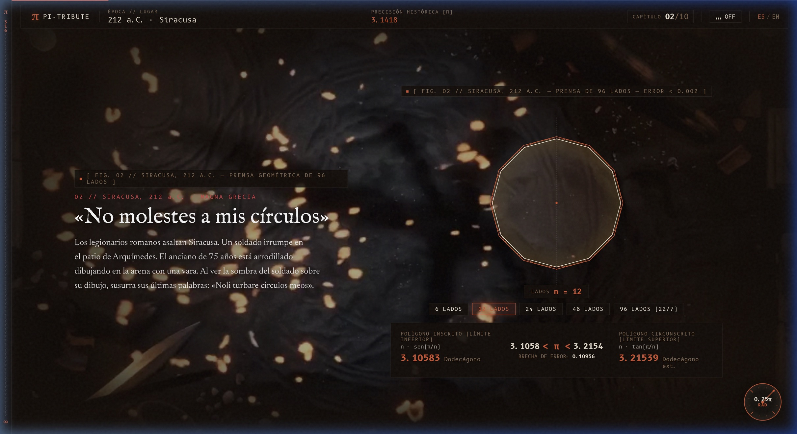
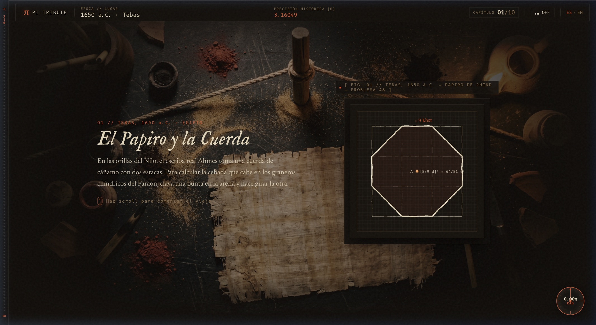
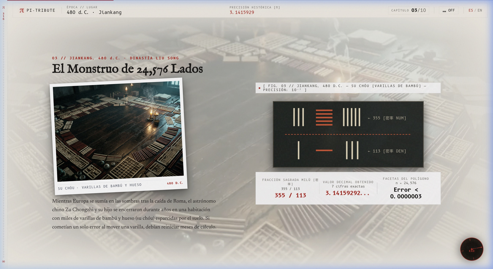
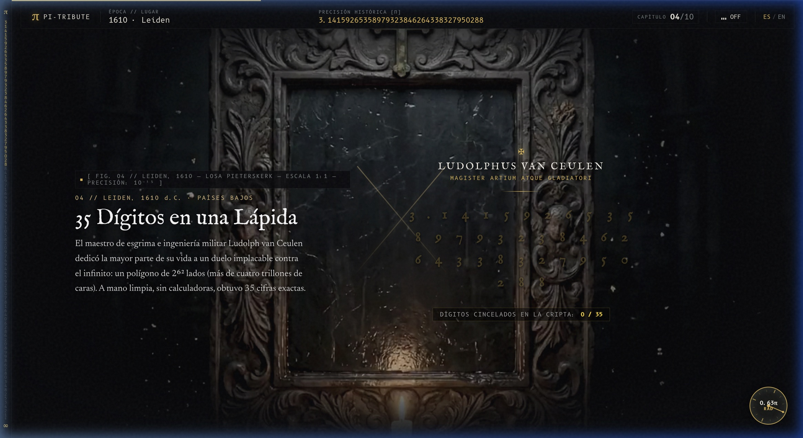
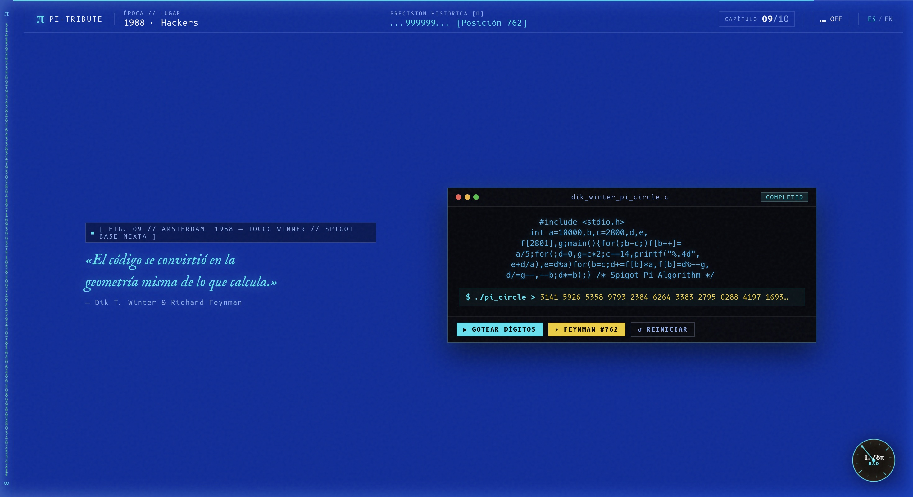

# π — Homenaje Cinematográfico al Infinito

> Documental interactivo de *scrollytelling* histórico y motor de visualización matemática en web de ultra-alto rendimiento.
> Reconstrucción técnica de cuatro milenios de cálculo geométrico, analítico y computacional del número π.

[](https://astro.build)
[](https://www.typescriptlang.org)
[-002FA7?style=flat-square)](#arquitectura-de-ingeniería)
[](#sistema-de-color-y-atmósfera)
[](#motor-de-video-scrubbing-y-scroll)

---



---

## Síntesis Ejecutiva (Lectura en 3 Segundos)

* **Qué es:** Una plataforma documental interactiva que recrea los diez momentos cumbre de la historia matemática de π, desde el escriba Ahmes en el antiguo Egipto (1650 a.C.) hasta los récords actuales de 105 billones de decimales calculados mediante algoritmos Chudnovsky en clústeres modernos.
* **Mecánica central:** La rueda del ratón y el gesto del trackpad operan como un cabezal de arrastre mecánico (*video-scrubbing 1:1 intra-frame*). El vídeo atmosférico de fondo, los diagramas vectoriales y los bloques narrativos avanzan y retroceden sincronizados al milímetro en cada frame.
* **Eficiencia extrema:** 0 KB de sobrecarga de frameworks cliente (sin React, Vue ni librerías de animación externas). Animaciones procesadas al 100% en la GPU mediante capas compuestas (*Composited Layers*), con diseño sonoro sintetizado proceduralmente en tiempo real a través de la Web Audio API (cero descargas de archivos de audio).

---

## Catálogo de Capítulos y Artefactos Históricos

El recorrido está segmentado en diez estaciones cronológicas, cada una con una identidad material, tipográfica y cromática propia:

### Capítulo I: Tebas, 1650 a.C. — El Papiro y la Cuerda
* **Hito histórico:** El escriba real Ahmes documenta en el Papiro de Rhind (Problema 48) el primer intento formal de cuadrar el círculo: tomar un diámetro, sustraer 1/9 y construir un cuadrado sobre los 8/9 restantes.
* **Aproximación:** $\pi \approx (16/9)^2 = 256/81 \approx 3.16049$.
* **Artefacto interactivo:** Recreación vectorial del papiro original con el compás de cuerda de cáñamo giratorio sincronizado con la rotación del astrolabio.



---

### Capítulo II: Siracusa, 212 a.C. — La Prensa Hidráulica Geométrica
* **Hito histórico:** Arquímedes sitúa el círculo en una tenaza entre dos polígonos regulares concéntricos (uno inscrito y otro circunscrito). Al duplicar las caras de 6 a 12, 24, 48 y finalmente 96 lados, acorrala la constante sin medir materia física.
* **Límites:** $223/71 < \pi < 22/7$ ($3.1408 < \pi < 3.1428$).
* **Artefacto interactivo:** Rig interactivo que calcula en tiempo real las cotas superior e inferior, el ángulo polar $(r, \theta)$ del cursor y contrae la distancia entre los perímetros conforme avanza el scroll.


---

### Capítulo III: Jiankang, 480 d.C. — El Monstruo de 24,576 Lados
* **Hito histórico:** Zu Chongzhi y su hijo calculan a mano en el suelo de su observatorio, manipulando varillas de bambú y hueso (*Su Chóu*), un polígono de 24,576 lados, obteniendo la fracción milagrosa Milü ($355/113$), récord que permaneció invicto durante ochocientos años.
* **Precisión:** 7 decimales exactos ($3.14159292...$).
* **Artefacto interactivo:** Ábaco matricial con la notación de varillas Han y panel de análisis fractal de facetas poligonales sobre papel de arroz.



---

### Capítulo IV: Leiden, 1610 d.C. — 35 Dígitos en una Lápida
* **Hito histórico:** El maestro de esgrima Ludolph van Ceulen consagra su existencia a calcular un polígono de $2^{62}$ lados (más de cuatro trillones de caras). En su testamento ordena cincelar sus 35 cifras exactas sobre su losa funeraria en la iglesia de San Pedro (Pieterskerk).
* **Artefacto interactivo:** Losa de piedra real con 35 glifos en bajorrelieve que se van grabando e iluminando en pan de oro conforme la rueda del ratón avanza, con retroalimentación acústica de cincel sintetizada en cada impacto.



---

### Capítulo V: Londres, 1706 d.C. — El Bautismo del Símbolo
* **Hito histórico:** William Jones introduce formalmente en su obra *Synopsis Palmariorum Matheseos* la letra griega $\pi$ para abreviar la engorrosa frase latina *«Quantitas in circulo quae cum diametro inscripta peripheriam definit»*. Leonhard Euler lo adopta en 1737, convirtiéndolo en estándar mundial.
* **Artefacto interactivo:** Simulador de compresión tipográfica que colapsa 68 caracteres de prosa latina en un único glifo de 280px con tinta orgánica batida.

---

### Capítulo VI: París, 1777 d.C. — El Teorema del Parquet
* **Hito histórico:** Georges-Louis Leclerc, Conde de Buffon, formula la probabilidad geométrica: arrojar agujas de longitud $L$ al azar sobre un suelo de tablas de separación $D$ permite derivar $\pi$ sin medir círculos ($P = 2L / \pi D$).
* **Artefacto interactivo:** Motor Monte Carlo que ejecuta en tiempo real el conteo de agujas caídas ($N$), intersecciones registradas ($C$) y convergencia viva del estimador $\pi \approx N / C$ flotando sobre parquet de Versalles.

---

### Capítulo VII: Houghton-le-Spring, 1873 d.C. — El Derrumbe de la Cúpula
* **Hito histórico:** William Shanks calcula a pluma 707 decimales a lo largo de veinte años, tallados en letras doradas en la cúpula del Palais de la Découverte en París. En 1944, una calculadora electromecánica demuestra que cometió un error en el decimal 528 (un 4 en lugar de un 5), invalidando de golpe las 180 cifras posteriores.
* **Artefacto interactivo:** Bóveda arquitectónica interactiva con detonador de alarma que simula la fractura del dígito 528 y el colapso en cenizas de los decimales corruptos.

---

### Capítulo VIII: Cambridge y Aberdeen, 1914 / 1949 — La Era del Silicio
* **Hito histórico:** Srinivasa Ramanujan descubre series modulares hiperconvergentes que entregan 8 cifras exactas por término. Tres décadas después, John von Neumann introduce estas relaciones en la computadora militar ENIAC (17,468 tubos de vacío), rompiendo 2,037 cifras en 70 horas continuas.
* **Artefacto interactivo:** Simulador electromecánico de tarjeta perforada IBM de 80 columnas con osciloscopio de fósforo P1 verde.

---

### Capítulo IX: Culto Hacker y Ámsterdam, 1988 / 1997 — Geometría en Código
* **Hito histórico:** El físico Richard Feynman populariza el punto decimal 762 (donde emergen seis nueves consecutivos: `999999`). Nueve años después, Dik Winter y Achim Flammenkamp ganan el concurso de C ofuscado (IOCCC) con 160 caracteres en C cuya disposición geométrica traza la silueta de un círculo y gotea dígitos mediante base mixta.
* **Artefacto interactivo:** Terminal Unix con el código circular ejecutable y resaltador analítico del punto de Feynman.



---

### Capítulo X: El Horizonte del Infinito — Presente y Futuro
* **Hito histórico:** La era moderna de supercómputo, algoritmos Chudnovsky y servidores distribuidos en la nube (superando los 105 billones de cifras).
* **Artefacto interactivo:** Motor de búsqueda indexado sobre un millón de decimales precomputados para localizar secuencias numéricas personales (fechas de nacimiento, códigos, identificadores) en tiempo submilimétrico.

---

## Arquitectura de Ingeniería

```
┌────────────────────────────────────────────────────────┐
│                        VIEWPORT                        │
│ ┌────────────────────────────────────────────────────┐ │
│ │                  .stage (100vh)                    │ │
│ │  position: sticky !important; top: 0;              │ │
│ │                                                    │ │
│ │  ┌──────────────────────────────────────────────┐  │ │
│ │  │   Capa 1: SceneVideo (Absolute Inset: 0)     │  │ │
│ │  │   Intra-frame H.264 (-g 1) + lerp(0.20)      │  │ │
│ │  └──────────────────────────────────────────────┘  │ │
│ │                                                    │ │
│ │  ┌──────────────────────────────────────────────┐  │ │
│ │  │   Capa 2: .stage-content.layout-split        │  │ │
│ │  │   Columna Izq: Narrativa & Beats (0.0 - 1.0) │  │ │
│ │  │   Columna Der: Instrumento / Artefacto       │  │ │
│ │  └──────────────────────────────────────────────┘  │ │
│ └────────────────────────────────────────────────────┘ │
└──────────────────────────┬─────────────────────────────┘
                           │
             Recorrido de Scroll: 420vh
                           │
                           ▼
```

### 1. El Contenedor Fijo Universal (`.stage`)
Para garantizar que los vídeos y los instrumentos no salgan de la pantalla ni dejen vacíos mientras el usuario se desplaza, cada escena posee una altura total de `420vh`, pero su contenedor interno `.stage` permanece clavado a la pantalla:

```css
.stage {
  position: sticky !important;
  top: 0 !important;
  left: 0 !important;
  width: 100% !important;
  height: 100vh !important;
  overflow: hidden !important;
  display: flex !important;
  flex-direction: column !important;
  align-items: center !important;
  justify-content: center !important;
  box-sizing: border-box !important;
  padding: 0 !important;
  z-index: 1;
}
```

### 2. Motor de Video-Scrubbing 1:1 con Interpolación Suave
Los clips cinematográficos de fondo están codificados con una estructura de fotogramas clave donde **cada cuadro es un Keyframe independiente** (`-g 1` en `ffmpeg`). Esto permite al navegador saltar a cualquier milisegundo exacto sin necesidad de reconstruir fotogramas predictivos:

```bash
ffmpeg -i input.mp4 -c:v libx264 -g 1 -keyint_min 1 -crf 22 -preset slow -an output.mp4
```

En el hilo de ejecución de cliente (`src/scripts/scroll.ts`), el tiempo del vídeo se interpola mediante amortiguación suave (*Linear Interpolation* a factor `0.20`), frenando con inercia orgánica o respondiendo instantáneamente al acelerar el trackpad:

```typescript
function renderVideoScrubLoop() {
  scrubStates.forEach((state) => {
    const diff = state.targetTime - state.currentTime;
    if (Math.abs(diff) > 0.008) {
      state.currentTime += diff * 0.20;
      if (!state.video.seeking) {
        state.video.currentTime = Number(state.currentTime.toFixed(3));
      }
    }
  });
  requestAnimationFrame(renderVideoScrubLoop);
}
```

### 3. Continuidad de Beats Narrativos
Para erradicar zonas muertas donde el texto desaparezca durante el scroll, la narrativa de cada capítulo se divide en tres intervalos contiguos con solapamiento suave:
* **Beat 1 (`0.00 - 0.40`):** Presentación del contexto histórico, fecha y protagonista. Visible por defecto desde el primer instante en que la escena entra en pantalla.
* **Beat 2 (`0.38 - 0.78`):** Despliegue del núcleo matemático o conflicto geométrico.
* **Beat 3 (`0.75 - 1.00`):** Sentencia de cierre y cita documental. Permanece activo hasta el final de la transición.

---

## Síntesis Sonora en Tiempo Real (Web Audio API)

No se realiza ninguna petición de red para archivos `.mp3` o `.wav`. Todos los efectos acústicos son generados matemáticamente en el navegador (`src/scripts/audio.ts`):

* **Cincel sobre piedra (Leiden):** Ráfaga ultracorta de ruido blanco procesada por un filtro pasa-banda (*Biquad Bandpass* a `2400 Hz`, $Q=8$) con decaimiento exponencial en 45 milisegundos.
* **Dígitos de alta precisión:** Tono senoidal puro cuya frecuencia fundamental se indexa en base al valor numérico del decimal proyectado ($440 \text{ Hz} \times 2^{n/12}$).
* **Reloj analógico de péndulo:** Pulso doble asimétrico de baja frecuencia emulando el escape mecánico de áncora.
* **Filamento ENIAC:** Zumbido armónico de 60 Hz sumado a modulación en anillo (*Ring Modulation*) simulando resonancia de tubos termoiónicos.

---

## Sistema de Color y Atmósfera (`data-theme`)

Los temas cromáticos no responden a modas de diseño web, sino a los **materiales y reactivos químicos reales** de cada época:

| Tema | Época / Material | Superficie (`--bg-surface`) | Tinta (`--fg-ink`) | Acento (`--accent`) |
| --- | --- | --- | --- | --- |
| `obsidian` | Papiro y Médula (Tebas) | `#120E0A` (Basalto) | `#E6D7B9` (Papiro) | `#D94E28` (Cinabrio egipcio) |
| `syracuse` | Arena y Fuego (Siracusa) | `#0D0807` (Ceniza) | `#FFFFFF` (Tiza) | `#E63946` (Hierro romano) |
| `china` | Papel de Arroz y Seda (Jiankang) | `#F4EFE6` (Arroz) | `#1C1917` (Tinta Sumi) | `#B91C1C` (Laca bermellón) |
| `leiden` | Pizarra Húmeda (Países Bajos) | `#08090B` (Pizarra) | `#EDE8DC` (Alabastro) | `#E5B94C` (Pan de oro) |
| `london` | Papel de Algodón (Londres) | `#F5F2EB` (Algodón) | `#111111` (Carbón) | `#B91C1C` (Sello de lacre) |
| `paris` | Roble y Bronce (París) | `#17120C` (Roble) | `#F0E6D6` (Lino) | `#D4A34B` (Bronce pulido) |
| `shanks` | Caoba y Oro (Exposición Universal) | `#0D0A12` (Bóveda) | `#FDFAF3` (Marfil) | `#E5A93C` (Oro imperial) |
| `eniac` | Acero Militar (Aberdeen) | `#050A07` (Chasis) | `#DFD3B9` (Manila IBM) | `#39FF88` (Fósforo P1) |
| `cyber` | Azul Ingeniería (IOCCC / Pasadena) | `#002FA7` (Klein) | `#FFFFFF` (Plano) | `#00F0FF` (Cian fósforo) |
| `infinite` | Luz Cuántica (Presente) | `#F4F1EA` (Alabastro) | `#090A0F` (Grafito) | `#002FA7` (Klein Blue) |

---

## Tipografía Editorial y Aeronáutica

* **B612 Mono:** Tipografía monoespaciada comisionada por Airbus para computadoras de vuelo. Utilizada en todas las salidas numéricas con propiedades estrictas de no-trepidación:
  ```css
  font-family: var(--font-mono);
  font-variant-numeric: tabular-nums slashed-zero;
  letter-spacing: -0.02em;
  ```
* **IM Fell English:** Reproducción de los tipos de metal cortados a mano en Londres en el siglo XVII. Se complementa con un filtro SVG procedimental en tiempo de renderizado (`#ink-displacement`) que perturba las aristas emulando sangrado de tinta sobre fibras de papel.
* **Newsreader & Instrument Serif:** Familias tipográficas para lectura reflexiva de largo formato inspiradas en tratados científicos y revistas académicas clásicas.

---

## Modo de Inspección Radiográfica (Blueprint Mode)

Para verificar y auditar en tiempo real la arquitectura interna de renderizado:

1. Mantén pulsada la tecla **`Alt`** o haz clic en el monograma `[π]` en la barra superior.
2. La interfaz conmuta a la vista técnica de ingeniería:
   * Las texturas y vídeos se atenúan al 15% de luminosidad.
   * La cuadrícula astronómica de 80px resalta en verde fluorescente (`#39ff88`).
   * Se imprimen en pantalla los valores dinámicos de la variable `--p: 0.XXXX`.
   * Se exponen los contornos estructurales de las capas compuestas en GPU.

---

## Instalación y Ejecución Local

### Requisitos
* Node.js 18.20+ o 20+
* Gestor de paquetes npm o pnpm

### Pasos
```bash
# 1. Clonar el repositorio
git clone https://github.com/luisrodriguez-rgb/Pi.git
cd Pi

# 2. Instalar dependencias
npm install

# 3. Iniciar el servidor local en segundo plano
astro dev --background

# 4. Comprobar estado y puerto (habitualmente http://localhost:4321/)
astro dev status

# 5. Generar compilación estática de producción
npm run build

# 6. Previsualizar la distribución final
npm run preview
```

---

## Estructura del Proyecto

```
src/
├── components/
│   ├── scenes/               # Los 10 capítulos cronológicos (01-Opening a 10-Library)
│   ├── ArchimedesRig.astro   # Prensa poligonal interactiva de 96 lados
│   ├── BambooRods.astro      # Simulador de varillas de cálculo chinas Su Chóu
│   ├── PunchCard.astro       # Tarjeta perforada electromecánica IBM de 80 columnas
│   ├── RhindArtifact.astro   # Geometría y cálamo del escriba Ahmes en papiro
│   ├── SceneVideo.astro      # Componente de fondo de vídeo con soporte de blending
│   ├── Astrolabe.astro       # Barra de progreso circular perimétrica en radianes
│   └── TopNav.astro          # HUD superior con época, precisión histórica y selector
├── data/
│   ├── formulas.ts           # Definiciones matemáticas exactas (Machin, Ramanujan, Spigot)
│   ├── milestones.ts         # Datos históricos, valores de precisión y esquemas cromáticos
│   └── pi-1m.txt             # Primer millón de dígitos decimales para búsqueda local
├── i18n/                     # Sistema de internacionalización bilingüe (Español / Inglés)
├── scripts/
│   ├── audio.ts              # Motor de síntesis procedural con Web Audio API
│   └── scroll.ts             # Motor de cálculo de --p e interpolación lerp(0.20)
└── styles/
    └── atmosphere.css        # Variables CSS, cuadrícula de 80px, layout split y pinning
```

---

---

## Despliegue en Cloudflare Workers y Pages

El proyecto está diseñado y optimizado para ejecutarse en la red perimetral global de **Cloudflare Pages**, aprovechando CDN Anycast, HTTP/3 y almacenamiento en caché inmutable para activos estáticos pesados.

### Arquitectura en Producción
* **Directorio de salida:** `dist/` generado mediante compilación estática de Astro (`npm run build`).
* **Cabeceras HTTP (`public/_headers`):**
  * Políticas de seguridad: `Content-Security-Policy`, `Strict-Transport-Security`, `X-Content-Type-Options: nosniff`, `X-Frame-Options: DENY`, `Referrer-Policy: strict-origin-when-cross-origin` y `Permissions-Policy`.
  * Reglas de caché: `public, max-age=31536000, immutable` para `/videos/*`, `/images/*`, `/screenshots/*` y activos compilados en `/_astro/*`.
  * Cabecera `Accept-Ranges: bytes` habilitada en vídeos para permitir peticiones por rangos parciales durante el scrubbing.
* **Redirecciones y Normalización (`public/_redirects`):**
  * Redirección 301 de `/en` hacia la ruta canónica `/en/`.
  * Alias retrocompatible de `/data/pi-1m.txt` hacia `/digits/pi-1m.txt`.
* **Configuración Wrangler (`wrangler.json`):**
  * Especifica el nombre de la aplicación `pi-tribute` y el directorio de publicación `dist` con observabilidad perimetral activa.

### Opciones de Despliegue

#### 1. Despliegue Directo vía CLI (Wrangler)
```bash
# Compilar y publicar directamente en Cloudflare Pages
npm run deploy

# O ejecutar paso a paso con el CLI de Wrangler:
npm run build
npx wrangler pages deploy dist --project-name=pi-tribute
```

#### 2. Previsualización Local con el Runtime de Cloudflare
Para verificar las cabeceras HTTP, directivas CSP y reglas de redirección en un entorno idéntico al borde de Cloudflare:
```bash
npm run preview:cf
```

#### 3. Integración Continua (Git en Cloudflare Dashboard)
1. Conectar el repositorio de GitHub en el panel de **Cloudflare Dashboard > Workers & Pages > Create application > Pages > Connect to Git**.
2. Parámetros de compilación:
   * **Framework preset:** `Astro`
   * **Build command:** `npm run build`
   * **Build output directory:** `dist`
   * **Node.js Version:** `22` o superior (`NODE_VERSION = 22.22.0` en variables de entorno).

---

## Licencia

Distribuido bajo licencia MIT. Desarrollado con dedicación a la historia de la ciencia y a los estándares de desarrollo web artesanal de alto rendimiento.
